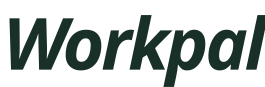

<picture>
  <source media="(prefers-color-scheme: dark)" srcset="docs/assets/logo-dark.svg">
  <source media="(prefers-color-scheme: light)" srcset="docs/assets/logo-light.svg">
  
</picture>

# Vision

**Make humans and AI agents work as one team.**

**English | [简体中文](VISION.zh.md)**

---

## Why "Workpal"

Workpal combines **Work** and **Pal**: a partner at work.

We want people and AI agents to become a real team, working toward shared goals with clear responsibilities,
shared context, and the ability to build on each other's contributions.

People bring judgment, experience, and direction. Agents take on concrete tasks, organize information, and
carry work forward. When something is unclear, they should ask. When work is blocked, they should say so.
Their results should be available for people to inspect, discuss, and verify.

Workpal aims to provide a shared workspace for that collaboration, making goals, tasks, progress, and decisions
visible, while keeping knowledge and experience available to the whole team.

**Help people and AI agents become a real team.** That is the idea behind Workpal.

---

## The vision, made concrete

Today, adding an AI agent often adds another inbox to manage.

Its work lives in a chat, a terminal, or a private session. Context stays in one person's head.
Decisions disappear into threads. When the work moves to another person or agent, the team has to
explain it all again.

The promise of AI is not a larger collection of tools. It is a more capable team.

In the future Workpal is building, work can begin wherever people already are: a customer
conversation, a Slack thread, or a few rough sentences describing what should change. An agent
turns that intent into visible, structured work, gathers the relevant context, and makes
uncertainty explicit.

If the task is clear, agents can move it forward. If it changes product behaviour, introduces
risk, or depends on a trade-off, the right person is brought in before the work continues. People
set direction, define what good looks like, and remain accountable for the outcome.

Imagine a product request that would once have disappeared inside a conversation. In Workpal, it
becomes a shared plan. Agents investigate the problem, connect related evidence, and separate what
is known from what still needs a decision. Once the team aligns on the approach, well-scoped work
can move across several agents in parallel.

The team does not review status theatre. It reviews the work itself: the plan, the document, the
implementation, the diff, the preview, the test result, and the unresolved questions. People can
redirect the work, raise the quality bar, approve the next stage, or stop it. Agents keep the
routine coordination moving without hiding what they are doing or why.

When the work is complete, its history does not vanish with the session. The original intent, the
decisions made, the actions taken, the artifacts produced, and the final outcome remain connected.
The next agent does not start from zero. A new teammate can understand not only what happened, but
why.

The same model applies wherever knowledge work moves through context, collaboration, and review.
Agents can organise research, prepare customer briefs, draft content, progress support work, or
coordinate client deliverables. Humans spend less time carrying information between tools and
chasing handoffs. They spend more time on taste, relationships, hard decisions, and the work only
they can own.

Workpal is not an autonomous company running beyond human control. It is the shared operating
system for people and agents doing consequential work together.

People set direction and remain accountable. Agents keep the work moving. Workpal preserves the
team's shared understanding and turns it into coordinated action.

**That is what it means to make humans and AI agents work as one team — and to become the system
of record and action for human-agent work.**

---

## Where we are on that path

This document describes the future Workpal is building, not a feature list. For what actually
works today, see the [README](README.md) — everything listed there is live, and each feature
links to its docs.
